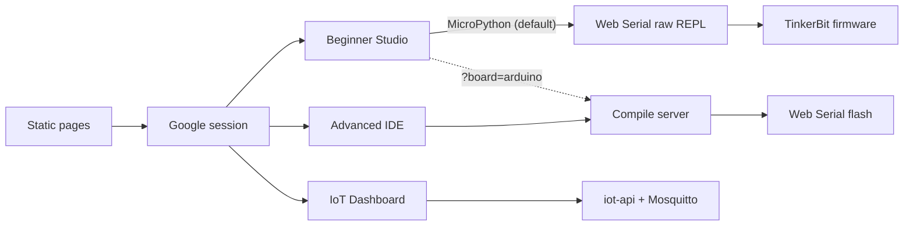
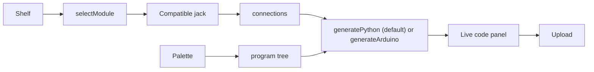
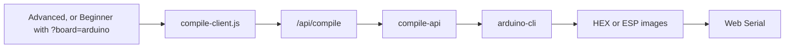
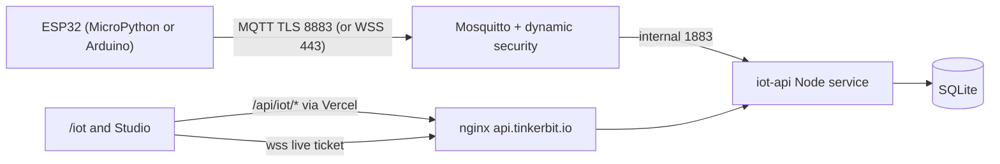
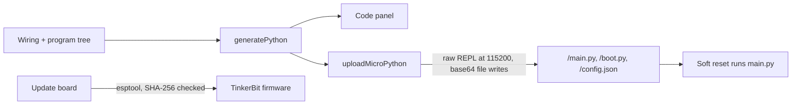

# TinkerBit — project documentation

**Product:** browser studio for the Maker ESP32 RJ11 kit  
**Modes:** Beginner (`/beginner`) and Advanced (`/ide`)  
**Audience:** students, teachers, and anyone who needs to see how the app is put together

This is the project document. It is written as five parts:

1. What TinkerBit is and what it includes  
2. How a person uses Beginner and Advanced  
3. The physical kit: modules, jacks, and the rules the software enforces  
4. How the software is built: pages, login, codegen, MicroPython upload, compile, and flash  
5. What can go wrong, how the app handles it, and where the code lives  

---

## 1. Product overview and features

TinkerBit is a web application for a physical electronics kit. The board is a Maker ESP32 with RJ11 jacks. Students plug sensors and actuators into those jacks, then program the board in a browser. They do not install anything, and they do not type code unless they want to read what the app generated (MicroPython in Beginner, C++ in Advanced).

The same kit is used in two products:

| Mode | URL | Who it is for | How you program |
|------|-----|---------------|-----------------|
| **Beginner Studio** | `/beginner` | First lessons, classrooms, kit tours | Pick a module, plug it into a jack, click action blocks. Live MicroPython appears on the side. |
| **Advanced IDE** | `/ide` | Students who already know blocks | OpenBlock Blockly. Generic pin blocks, kit device blocks, motors, I2C, and Blynk. |

The two modes reach the board in different ways, both from the browser over USB (Web Serial):

- **Beginner** sends a MicroPython program straight to the board, with no compile step and no server in between, so it keeps working offline once the page has loaded. The board runs the **TinkerBit firmware**: MicroPython with the kit library built in, installed once per board with **Update board** (section 4.8). Teachers can switch Beginner back to Arduino C++ with `?board=arduino`.
- **Advanced** compiles an Arduino sketch on a server and flashes it (section 4.5). Flashing replaces the TinkerBit firmware, so a board used in Advanced needs Update board before the next Beginner upload.

Chrome or Edge on a computer is required. A phone or Firefox cannot open the USB port.

There is no student project database in this repository. Work lives in the browser session. Beginner templates load a ready-made wiring and program. Advanced projects use the IDE’s own save path.

### 1.1 What the product includes

**Accounts**

- Google sign-in before Choose, Beginner, or Advanced.  
- A **Choose** page: Beginner or Advanced. You can go back and switch.  
- Localhost can open Choose without a session so developers can work offline.

**Beginner Studio**

- A drawing of the Maker ESP32 with labeled jacks (ST, D13, 3D, D5, MD, I2C, A1–A4, ESP, UART).  
- A shelf of kit modules. Click a module, then click a jack that accepts it. Illegal jacks stay blocked and show a short hint.  
- SVG cables from jack to module card. Cards can be dragged; the cable midpoint can bend. Moving a card does not change the GPIO in the sketch.  
- A project library and a quick-start strip. Opening a project lands on **Build**, not Code, so the student sees the wiring first.  
- A Code view: wait, repeat, if/else, print text, print a variable, plus one action per wired module (LED on/off/blink/brightness, read soil, print climate, and so on).  
- A live code panel ("Your program as MicroPython") that updates whenever wiring or blocks change. That text is what Upload sends, as `main.py`.  
- **Connect board**, **Upload**, and a serial monitor at **115200** (9600 when the project has an HC-05, which shares the USB serial line). **Start** restarts the board so the program's first lines show.  
- **Update board** in the account menu: shows what the board runs and installs the TinkerBit firmware.  
- A status bar that prints the jack map so a teacher can check a cable without opening this document.

**Advanced IDE**

- The OpenBlock / Scratch-style workspace: toolbox, canvas, hardware header, serial console.  
- Maker ESP32 categories that were already there: digital write/read, analog read, L293D motors, stepper, I2C begin, Blynk.  
- Maker Kit categories that match Beginner: sensors, outputs, radio (onboard BLE and HC-05). Every kit part has a block, including IR, PIR, reed, LDR, flame, water level, MPU6050, buzzer tones, LED brightness, pump and door lock.  
- Compiles on the server and flashes over USB. This replaces the TinkerBit firmware on the board.

**Upload and hardware**

- Beginner (MicroPython): no compile. Upload writes `main.py` (plus the library files or Cloud settings when needed) through the MicroPython raw REPL at 115200, then restarts the program. A 3 KB program takes about 1 s.  
- Advanced, and Beginner with `?board=arduino`: compile on a server (`arduino-cli`). The browser only receives firmware and writes it over USB.  
- ESP32 download mode (Arduino flashing and Update board): classic auto-reset, slower laptop timing, USB-JTAG reset, then “hold BOOT”.  
- Arduino Uno support stays in the code for old Advanced projects; the board list shows only the Maker ESP32.  
- Beginner MicroPython programs print at 115200 (9600 with an HC-05). Arduino kit sketches print at 9600, Blynk sketches at 115200. The serial console must match.

### 1.2 What the product does not do

- It does not replace the Arduino IDE for arbitrary sketches you type yourself (Advanced can, but the compile server only allows three board types).  
- It does not store class rosters or cloud projects in this repo.  
- It does not run on Safari, Firefox, or a phone for upload.  
- It does not ship Arduino sensor libraries to the browser. For Arduino sketches, the Servo, OLED, RFID, and pulse libraries must already be on the compile server. MicroPython drivers are part of the TinkerBit firmware.  
- It does not run Edge AI in MicroPython yet. Edge AI needs Arduino mode (`?board=arduino`).

---

## 2. User point of view

This section is the path a student or teacher actually takes.

### 2.1 First visit

1. Open the site.  
2. Sign in with Google.  
3. On **How do you want to code?**, pick **Beginner** or **Advanced**.

Beginner is the kit lesson: wire, click blocks, read the MicroPython, upload. Advanced is the full block IDE: more control, Blynk, and generic pins.

### 2.2 Beginner — a typical lesson

**Build is the home screen.** After you pick a template, you still land on Build.

**Wire**

1. Click a module in the shelf, for example **LED**.  
2. Legal jacks highlight. For an LED the first choice is **D13** (GPIO 33). A1, A2, A3 also work. D5 does not — that jack is reserved for the ultrasonic sensor.  
3. Click the jack. A card and a cable appear.  
4. Add the rest of the lesson the same way. Some modules have only one jack:

   - HC-SR04 → **D5** only (Trig GPIO 26, Echo GPIO 25).  
   - RFID → **3D** only. Do not use D13 at the same time; they share GPIO 33.  
   - L293D or 4-channel relay → **MD**.  
   - Stepper → **ST**.  
   - OLED and HW-605 → **I2C** (they share the bus).  
   - Onboard BLE → no cable; it attaches to **ESP**.  
   - HC-05 → **UART** (RX GPIO 3, TX GPIO 1 — the same UART as USB).

5. If a jack is wrong, the app shows a short reason instead of connecting.

**Program**

6. Open **Code**. The palette lists control blocks and the actions of whatever you wired.  
7. Click **On / Off**, **Brightness**, **Blink**, **Read distance**, **Print soil moisture**, and so on.  
8. LED brightness is 0–255 PWM on the same pin as On/Off.  
9. Use **If…then** to compare a sensor (soil below 40, distance under 20 cm, button pressed).  
10. Watch the code panel (MicroPython). You do not edit it for a normal lesson.

**Upload and see output**

11. Use **Chrome or Edge** on a computer. Use a data USB cable.  
12. Close Arduino IDE Serial Monitor, Thonny, PuTTY, or another TinkerBit tab. Only one program can own the COM port.  
13. Click **Connect board** and pick the ESP32 in the browser list.  
14. The first time a board is used here (new kits come with an Arduino demo, and Advanced flashes Arduino too), open the account menu, choose **Update board** and install the TinkerBit firmware. This is once per board. Upload says so when it finds no MicroPython.  
15. Click **Upload**. The Studio checks the board, stops the last program, installs the library files if they changed, writes your program as `main.py` and starts it. It usually takes a few seconds and uses no server. (With `?board=arduino` the sketch compiles on the server first, which can take minutes the first time.)  
16. Start the serial monitor. Start restarts the board, so you see `TinkerBit Beginner ready` and then a line for each action (`LED: ON`, `HC-SR04 cm=42`, `Soil moisture=61 %`).

**If Upload says the board is not ready**

- "This board does not have MicroPython": run **Update board** once.  
- "Older TinkerBit firmware": run **Update board**. "Newer TinkerBit firmware than this page": reload the page.  
- "Cloud needs the TinkerBit firmware": the board has plain MicroPython; run **Update board**.  
- A program that never gives control back (including HC-05 programs, which turn off Ctrl-C) is handled by Upload itself: it restarts the board in safe mode, which skips `main.py`.

**If Update board (or an Arduino upload) sticks at about 5%**

The firmware is ready. The board has not entered download mode. On many laptops the USB chip does not pulse DTR/RTS correctly.

- Hold **BOOT** on the board until progress moves past ~12%, then release.  
- Prefer a USB 2.0 port or a different cable.  
- Unplug, wait two seconds, plug in, Connect again, then Upload while holding BOOT.

**If the serial window is empty or looks like noise**

- Beginner MicroPython programs use **115200**, or **9600** when the project has an HC-05. The monitor follows the project.  
- Arduino kit sketches (Advanced, or Beginner with `?board=arduino`) use **9600**; Blynk sketches use **115200**. Set the hardware console to match the sketch you actually flashed.  
- After an upload, press Start again. Start restarts the board; if nothing appears within 4 s, press RST once (some laptops start the board in its flashing mode when it is plugged in).

### 2.3 Advanced — a typical session

1. Open `/ide`. It starts on the Maker ESP32, the only board in the board list. Other OpenBlock boards stay in the code (hidden by `KIT_DEVICE_ID` in [devices/index.jsx](src/lib/libraries/devices/index.jsx)), so old projects saved for them still open.  
2. Drag blocks from **Maker Kit Sensors**, **Maker Kit Outputs**, or **Maker Kit Radio**, or from Digital / Analog / Motors / Stepper / I2C / Blynk.  
3. On kit blocks, pick the jack (D13, A1, …). Labels match Beginner. A4 is shown as **A4 (BOOT)**. D5 is not in any jack list: only the HC-SR04 block uses it. Old projects saved with D4 or D5 fall back to D13 and the sketch says so in a comment.  
4. Connect and Upload. Advanced always compiles an Arduino sketch, which replaces the TinkerBit firmware: run Update board before using that board in Beginner again.  
5. Open the hardware console at 9600 for kit sketches.

### 2.4 Classroom checklist

- Browser: Chrome or Edge, desktop, HTTPS or localhost.  
- Driver: if Windows does not show a COM port, install CH340 or CP210x for your USB chip. TinkerBit does not ship that driver.  
- One serial owner: close the Arduino IDE monitor (or Thonny) before Connect.  
- Firmware: run **Update board** once per board before the first Beginner lesson. A board last used in Advanced needs it again.  
- Cable: data cable, not charge-only.  
- Jacks: follow the table in section 3. Wrong jack is the most common hardware fail (DHT on D13, RFID plus LED on D13, ultrasonic on a single digital pin).

---

## 3. Kit catalog, jacks, and software rules

Beginner only offers modules that exist in the physical kit. Advanced kit blocks use the same GPIO map.

### 3.1 Jack map

| Jack | GPIOs | What it is for |
|------|-------|----------------|
| ST | 12, 13, 14, 27 | 4-wire stepper |
| D13 | 33 | Button, LED, 1-ch relay, servo (not DHT if you can avoid it) |
| 3D | 32 SS, 33 RST, 34 MISO; SPI SCK 16, MOSI 23 | RFID RC522. Conflicts with D13. |
| D5 | Echo 25, Trig 26 | HC-SR04 only. Echo must stay INPUT. |
| MD | 17, 5, 18, 19 | L293D motor A/B or 4-ch relay (active-low) |
| I2C | SDA 21, SCL 22 | OLED and/or HW-605 |
| A1 | 4 | Analog sensors; preferred DHT pin |
| A2 | 15 | Analog (strapping pin) |
| A3 | 2 | Analog (strapping pin) |
| A4 | 0 | Analog / BOOT. Do not hold LOW at reset. |
| ESP | — | Onboard BLE |
| UART | RX 3, TX 1 | HC-05 at 9600; shares UART0 with USB serial and the MicroPython REPL |

### 3.2 Modules and what the student can do

| Module | Typical jack | Actions in Beginner |
|--------|--------------|---------------------|
| Push button | D13 | Is pressed? (INPUT_PULLUP) |
| Potentiometer | A1–A4 | Read knob 0–4095 (averaged) |
| LED | D13 | On/Off, Brightness 0–255 PWM, Blink |
| Relay (1 ch) | D13 | On/Off |
| Servo | D13 | Set angle (ESP32Servo) |
| L293D | MD | Motor A/B speed and direction, stop |
| 4-ch relay | MD | Channel on/off, all off (active-low) |
| Stepper | ST | Move steps at an RPM |
| OLED | I2C | Show text, show number |
| MQ-2 | A1–A4 | Read / print raw gas (heater needs ~1 min; not ppm) |
| Microphone | A1–A4 | Read loudness |
| HW-605 pulse | I2C | Read BPM (MAX30102 @ 100 kHz) |
| MPU6050 motion | I2C | Tilt in degrees and shake 0–100 (plain `Wire`, address 0x68 or 0x69); the sensor Edge AI learns moves from |
| Capacitive soil | A1–A4 | Moisture 0–100% |
| DHT11 | A1 | Temp, humidity, print climate (sample every 2 s) |
| HC-SR04 | D5 | Distance cm (invalid echo → −1) |
| RFID RC522 | 3D | Read UID |
| BLE (onboard) | ESP | Advertise name, send text |
| HC-05 | UART | Send line, read line |

Control blocks (no jack): Wait, Repeat, If…then, Print text, Print variable.

### 3.3 Rules the software enforces

These are the reasons a jack stays grey, or a sketch comment appears.

| Rule | Why it exists | What the app does |
|------|---------------|-------------------|
| D13 and 3D cannot be used together | Both use GPIO 33 (D13 signal and RFID RST) | The second jack is blocked. Hint: unplug the other first. |
| D5 is ultrasonic only | Dual pins; driving Echo as an output heats the module | Digital modules cannot take D5. Code keeps Echo as INPUT. |
| A4 is BOOT (GPIO 0) | LOW at reset enters download mode | Dropdown says **A4 (BOOT)**. Code comments warn before `pinMode`. |
| DHT prefers A1 | GPIO 33 is a poor DHT data pin on this ESP32 | Auto-assign tries A1, A2, A3, then D13. Fail text says plug into A1. |
| RFID SPI is not on D5 | Ultrasonic already owns 25/26 | SCK=16, MOSI=23; SS/RST/MISO on 3D. |
| UART is USB serial | HC-05 RX/TX are U0RXD/U0TXD | Arduino: send/receive use `Serial` at 9600. MicroPython: the program moves the line to 9600 and turns off Ctrl-C (`kbd_intr(-1)`), so the monitor opens at 9600 and Upload gets back in through safe mode. Do not open a second monitor. |
| I2C is shared | OLED, HW-605 and MPU6050 are all 3.3 V I2C | They may share the I2C jacks; `Wire.begin` runs once. Pulse init uses 100 kHz, not 400 kHz. A missing MPU6050 is retried every 5 s and reads shake −1. |
| Soil is capacitive | Dry ≈ high ADC, wet ≈ low | Map raw ~3200→0%, ~1200→100%. Raw ≈ 0 is a cable fail. |
| MQ-2 / mic / pot noise | Single ADC reads swing | Average 12–16 samples with a short delay. |
| Analog is ADC2 | WiFi/BLE steal ADC2 | Comments: turn the radio off for stable reads. |
| 4-ch relay is active-low | Floating LOW turns channels on at power-up | Setup writes HIGH to 17/5/18/19 (off). ON drives LOW. MicroPython: `boot.py` does it on every boot, before `main.py`. |
| A2, A3, ST are strapping pins | Wrong level at reset can change boot | Jacks are flagged; A4 is the strongest warning. |
| Copies only on shared jacks | Parts with their own jack, I2C address or radio cannot be doubled | One-wire and analog parts (D13, A1–A4) can be added again: the copy keeps a number for life (`conn.n`), is named "LED 2" and reads into `name2` variables. Others say "already on the board". See [partCopies.js](src/beginner-studio/domain/partCopies.js). |

LED default pin is **D13 = GPIO 33**. Brightness uses `analogWrite` on that same pin.

---

## 4. Technical capability

The running system has four layers, plus the optional TinkerBit Cloud service (section 4.6). Cloud has its own SQLite database; nothing else stores application data.

### 4.1 Pages and hosting

Webpack writes several HTML apps into `build/` ([webpack.config.js](webpack.config.js)). [vercel.json](vercel.json) maps clean URLs onto those files and sets security headers (no iframe, no sniff).

| URL | Built as | Purpose |
|-----|----------|---------|
| `/` | landing | Marketing |
| `/login` | login | Google sign-in |
| `/choose` | choose | Beginner vs Advanced |
| `/beginner` | beginnerStudio | Kit studio |
| `/ide` | IDE bundle | OpenBlock GUI |
| `/iot`, `/iot/*` | iot | IoT Dashboard, full page (phone friendly) |

Local development is usually `http://127.0.0.1:8601`.

[middleware.js](middleware.js) runs on `/choose`, `/beginner`, `/ide`, and `/iot`. If auth is on and the session cookie is missing, the request goes to `/login?next=...`. If auth is off, the pages open. If auth is on but `AUTH_SECRET` or `GOOGLE_CLIENT_ID` is missing, login fails closed.

`/api/compile` and `/api/compile/health` are not implemented in the frontend host. They are rewritten to the compile server. `/devices/*` and `/extensions/*` for the Advanced IDE are rewritten the same way.

### 4.2 Sign-in

| Step | File |
|------|------|
| Redirect to Google | [api/auth/google.mjs](api/auth/google.mjs) |
| Exchange code, set cookie | [api/auth/callback.mjs](api/auth/callback.mjs) |
| Who is signed in | [api/auth/me.mjs](api/auth/me.mjs) |
| Clear cookie | [api/auth/logout.mjs](api/auth/logout.mjs) |

[lib/auth/session.mjs](lib/auth/session.mjs) signs the session. After login, `next` may only be `/choose`, `/beginner`, `/ide`, or `/iot`. The choose page calls [src/lib/auth-client.js](src/lib/auth-client.js). On localhost it allows the page through without a session.

### 4.3 Beginner Studio internals

[src/beginner-studio/App.jsx](src/beginner-studio/App.jsx) is a shell: top bar (Build / Code), quick start, the active view, status bar, project library.

State lives in [src/beginner-studio/context/StudioContext.jsx](src/beginner-studio/context/StudioContext.jsx):

- `connections` — `{ id, moduleId, portId, pin, offsetX, offsetY, bendX, bendY }`  
- `program` — nested block tree (`children`, `elseChildren`)  
- `selectedModule` — module waiting for a jack click  
- `view` — `'build'` on first load and after a template load  
- theme, project name, palette filters  

[src/beginner-studio/hooks/useStudioActions.js](src/beginner-studio/hooks/useStudioActions.js) is the only place that mutates that state. Wiring is **select then click**, not drag-onto-a-port. BLE calls `connect` on `ONBOARD` immediately.

| File | Role |
|------|------|
| [modules.js](src/beginner-studio/domain/modules.js) | Catalog, actions, includes |
| [ports.js](src/beginner-studio/domain/ports.js) | Jacks, GPIO, conflicts, `pickPortForModule` |
| [tree.js](src/beginner-studio/domain/tree.js) | Append, nest, delete blocks |
| [boardLanguage.js](src/beginner-studio/domain/boardLanguage.js) | MicroPython (default) or Arduino; `?board=arduino` / `?board=micropython`, remembered per browser |
| [pycodegen.js](src/beginner-studio/domain/pycodegen.js) | MicroPython `main.py` for the `tinkerbit` library (section 4.8) |
| [codegen.js](src/beginner-studio/domain/codegen.js) | Arduino sketch: includes, setup, loop, helpers |
| [templates.js](src/beginner-studio/domain/templates.js) | Named projects → connections + program |
| [useGeneratedCode.js](src/beginner-studio/hooks/useGeneratedCode.js) | Memoized program text in the active language |
| [BoardCanvas.jsx](src/beginner-studio/components/build/BoardCanvas.jsx) | SVG board, ports, cables |
| [useBoardUpload.js](src/beginner-studio/hooks/useBoardUpload.js) | Connect; Upload (MicroPython over the REPL, or compile and flash for Arduino); Update board |
| [useSerialMonitor.js](src/beginner-studio/hooks/useSerialMonitor.js) | Monitor at 115200 for MicroPython (9600 with an HC-05) or 9600 for Arduino; Start restarts the board |

**MicroPython (default).** `main.py` imports `tinkerbit`, creates one object per wired part by jack name (`led = tinkerbit.Led("D13")`), prints `TinkerBit Beginner ready`, runs the setup lines, then loops over the program tree in `while True:`. GPIO numbers live only in the library's `board.py`. Details in section 4.8.

**Arduino (`?board=arduino`).** Every generated sketch starts with `Serial.begin(9600)`, a short delay, and `TinkerBit Beginner ready`. Setup then configures only the modules that are actually wired. Loop is the program tree. Helpers (DHT bit-bang, `readAnalogAvg`, `soilRawToPercent`, `getDistanceTrigEcho`, RFID, BLE) are included only when needed.

### 4.4 Advanced IDE internals

The IDE shell is [src/containers/gui.jsx](src/containers/gui.jsx) (OpenBlock VM + Blockly). Maker ESP32 is a static extension:

| File | Role |
|------|------|
| [pin-map.js](static/extensions/makerEsp32/pin-map.js) | Same GPIO numbers as Beginner |
| [blocks.js](static/extensions/makerEsp32/blocks.js) | Block shapes |
| [toolbox.js](static/extensions/makerEsp32/toolbox.js) | Digital, Analog, Motors, Stepper, I2C, Kit Sensors, Kit Outputs, Kit Radio, Blynk |
| [generator.js](static/extensions/makerEsp32/generator.js) | C++ per block; kit helpers copied from Beginner |
| [translations.js](static/extensions/makerEsp32/translations.js) | Labels |

Sensor blocks read the same active level as Beginner (IR, reed and flame are LOW when triggered; PIR and LDR are HIGH). Pump, lock and buzzer blocks write LOW in setup so a relay does not click on at boot. The MPU6050 blocks add the same raw-Wire driver Beginner uses. [maker-esp32-extension.test.js](test/unit/maker-esp32-extension.test.js) checks that every toolbox block has a shape, a label and a generator.

Unlike Beginner, the IDE does not stop two blocks from using pins that share a GPIO (D13 and the RFID reset are both GPIO 33).

Kit blocks force `Serial.begin(9600)`. Blynk blocks force `Serial.begin(115200)`. If both appear in one workspace, the last `Serial.begin` the generator writes wins. Match the console to that sketch.

### 4.5 Compile and flash

Used by the Advanced IDE, by Beginner with `?board=arduino`, and by the Edge AI recorder (Arduino only). Beginner's default MicroPython upload skips this path entirely (section 4.8).

**Browser.** [src/lib/web-serial/compile-client.js](src/lib/web-serial/compile-client.js) POSTs `{ source, fqbn }` (3 minute timeout) and checks `/api/compile/health`.

[src/lib/web-serial/device-profiles.js](src/lib/web-serial/device-profiles.js):

| Board | FQBN | Flash | Monitor | Open for flash |
|-------|------|-------|---------|----------------|
| Uno | `arduino:avr:uno` | STK500 | 9600 | 115200 |
| Maker ESP32 | `esp32:esp32:esp32` | esptool | 9600 | 115200 |
| ESP32-S3 | `esp32:esp32:esp32s3` | esptool | 9600 | 115200 |

[src/lib/web-serial/upload-pipeline.js](src/lib/web-serial/upload-pipeline.js): refuse a second upload, compile, stop the monitor, close the port, flash, close again, notify the monitor.

ESP32 boot ([esptool-flash.js](src/lib/web-serial/esptool-flash.js)), in order:

1. Classic DTR/RTS reset  
2. Slower reset (laptop USB timing)  
3. USB-JTAG reset  
4. Manual BOOT (log: hold the button; 60 s timeout)

Flash baud stays **115200**. Faster rates fail on common CP210x chips. Progress near 5% is bootloader connect, not compile.

[web-serial-port.js](src/lib/web-serial/web-serial-port.js) retries `open()` after a delay (Windows often fails if reopen is instant). [errors.js](src/lib/web-serial/errors.js) maps “port busy”, “insecure origin”, and “failed to connect” into short sentences.

**Server.** [services/compile-api/server.js](services/compile-api/server.js) listens on localhost. `GET /health` → `{ ok: true }`. `POST /api/compile` accepts only the three FQBNs and a sketch up to 128 KB. It writes a temp sketch, runs `arduino-cli`, deletes the folder. Uno → HEX. ESP32 → flash images plus a cleared OTA-data region so the new app boots. Blynk headers add the Blynk library path if that folder exists on the machine. Sensor libraries (ESP32Servo, SSD1306, MFRC522, MAX3010x) must already be installed there.

> **Transport.** Vercel rewrites `/api/compile` to `https://api.tinkerbit.io/api/compile`, so sketches (Arduino Cloud sketches carry the WiFi password and device key) are encrypted all the way to the EC2 host. MicroPython Cloud projects never send these to any server: they go to the board's `/config.json` over USB. `/devices/*` and `/extensions/*` are public static files and still go to `http://13.127.144.30`.

### 4.6 TinkerBit Cloud (IoT)

Students add the onboard **TinkerBit Cloud** part in Beginner Studio. The board joins WiFi, talks MQTT to our broker, and shows up on `/iot`, where they see readings, flip dashboard switches and sliders, and get alerts. Pilot scale: about 100 boards on the existing EC2 host.

| Piece | Where | Notes |
|-------|-------|-------|
| Broker | [services/iot-api/deploy/mosquitto.conf](services/iot-api/deploy/mosquitto.conf) | One login and ACL `tb/<id>/#` per board; anonymous off; 4 KB packets |
| Service | [services/iot-api/](services/iot-api/) | HTTP API, live WebSocket, ingest, alert rules, rollups, backups. Runbook in its [readme](services/iot-api/readme.md) |
| Firmware (Arduino) | [cloudFirmware.js](src/beginner-studio/domain/cloudFirmware.js) | `esp-mqtt` on its own FreeRTOS task; ISRG roots; falls back to WSS on 443 behind strict firewalls; failsafe values when offline |
| Firmware (MicroPython) | [cloud.py](prototypes/micropython/lib/tinkerbit/cloud.py), [tbcloud.c](prototypes/micropython/firmware/cmodules/tbcloud/tbcloud.c), `micropythonCloudConfig` in [pycodegen.js](src/beginner-studio/domain/pycodegen.js) | WiFi from Python; MQTT over TLS in the `tbcloud` C module (esp-mqtt on its own task, ISRG roots, WSS fallback remembered on the board). Same topics, telemetry, controls, alerts and checklist lines as the Arduino firmware. Settings come from `/config.json`. Needs the TinkerBit firmware |
| Studio IoT Dashboard | [CloudView.jsx](src/beginner-studio/components/cloud/CloudView.jsx), [useCloudSetup.js](src/beginner-studio/hooks/useCloudSetup.js), [cloudSecrets.js](src/beginner-studio/domain/cloudSecrets.js) | Opened by the top-bar "IoT Dashboard" button (asks to add the Cloud part first). Split 30/70: board list on the left, and on the right the project's board, WiFi and upload steps, its going-live checklist, or a board's full dashboard |
| Board list | [DeviceManager.jsx](src/beginner-studio/components/cloud/DeviceManager.jsx) | The project's board pinned at the top ("This project"), other boards below, add a board, QR code to the phone dashboard. Narrows to 230 px for one board, to a rail of dots while a dashboard is edited, and to a dropdown under 900 px |
| Board dashboard | [DeviceDashboard.jsx](src/beginner-studio/components/cloud/DeviceDashboard.jsx) (lazy chunk `studio-iot`), [cloudPanel.js](src/beginner-studio/domain/cloudPanel.js) | Reuses the `/iot` store and Dashboard, Alerts and Settings tabs (risky settings folded under Advanced). Clicking a board only shows it; a strip says which board the project uploads to, and "Use for this project" switches after a confirm. Auto-named widgets on the project's board show part names |
| Add Cloud | [CloudAddDialog.jsx](src/beginner-studio/components/cloud/CloudAddDialog.jsx) | Adds the Cloud part (lists parts in the way), then opens the IoT Dashboard |
| Going live | [useCloudLive.js](src/beginner-studio/hooks/useCloudLive.js), [cloudProgress.js](src/beginner-studio/domain/cloudProgress.js) | Reads the board's USB messages and polls the Cloud service after a Cloud upload |
| Dashboard | [src/iot/](src/iot/) | Boards list, widget grid (drag to move, drag the corner to resize, tap a tile for a settings panel with live preview; layout is a flowing grid so phones and desktops share it), alert rules, settings, data export/delete |
| Browser client | [src/lib/iot-api.js](src/lib/iot-api.js) | Same-origin `/api/iot/*` (Vercel rewrite → `https://api.tinkerbit.io/iot/v1/*`; dev proxy → `127.0.0.1:20114`) |

Rules the software enforces:

- **A1–A4 are off while Cloud is on.** WiFi takes over the ESP32's ADC2, which those jacks use. The shelf, jacks, 3D board and upload all refuse parts that need them; Cloud templates use D13, D5, MD and I2C only.
- **Cloud and BLE cannot be in the same project** (radio and flash budget).
- **Secrets never sit in the code panel.** The preview shows `********`; real values are put in only inside the Upload handler and masked in compile logs. The device key stays in this browser's localStorage (per account); the WiFi password stays in sessionStorage unless "remember on this computer" is ticked. The server never sees the WiFi password. In MicroPython mode both go into `/config.json`, written over USB at Upload and never shown or logged; uploading a project without Cloud removes an earlier project's `/config.json`.
- **Unsaved dashboard edits are never lost silently.** Switching boards, leaving the IoT page from the top bar, or starting an upload asks first (`canLeave` in [router.js](src/iot/router.js)).
- **Telemetry** sends only the variables of input parts that the program actually reads, at most every 5 s. Dashboard controls arrive instantly (retained MQTT state with versions and acks).

Local development: `cd services/iot-api && npm run dev` (see its readme), then `npm start` here; the dev server proxies `/api/iot`.

### 4.7 Edge AI

Students teach the board to tell 2–4 things apart by recording examples, then use "If the AI thinks it is …" blocks. The model runs on the ESP32 itself; no server and no internet are involved. Two kinds: **Motion** (moves made with the MPU6050) and **Sensors** (moments the wired sensors notice together, such as an empty room or someone at the door).

**Arduino mode only for now.** The recorder and the AI program are Arduino sketches, and flashing them would replace the TinkerBit firmware. In MicroPython mode (the default) the Edge AI page says "Coming soon in MicroPython", AI templates are greyed out, and Upload refuses a project with AI blocks ("Edge AI is coming soon in MicroPython. Remove it from your project to upload."). Use `?board=arduino` for Edge AI lessons.

| Piece | Where | Notes |
|-------|-------|-------|
| Page | [AiView.jsx](src/beginner-studio/components/ai/AiView.jsx), [ThingList.jsx](src/beginner-studio/components/ai/ThingList.jsx) | Opened by the top-bar "Edge AI" button (its dot and tooltip say what is missing). Split 30/70: the things the AI knows on the left; on the right what it learns, get the board ready, teach it, try it and use it. Stacks under 900 px |
| Rules and limits | [aiKinds.js](src/beginner-studio/domain/ai/aiKinds.js) | Kinds, which readings Sensors uses (in a fixed sorted order), name checks, `aiProblem()` (the one next step, shown in the top bar and on Upload), Cloud keys `ai_<name>` |
| Saved state | [aiState.js](src/beginner-studio/domain/ai/aiState.js), [autosave.js](src/beginner-studio/domain/autosave.js), [useAiActions.js](src/beginner-studio/hooks/useAiActions.js) | `ai: {kind, things, samples, sig}` is saved with the project (autosave v1 with an optional field, so older tabs ignore it). One recording is one undo step; undo is paused while recording |
| Model | [knn.js](src/beginner-studio/domain/ai/knn.js) | 3 nearest neighbours on standardised features; a tie goes to the nearest. "Not sure" past 3× the usual same-thing gap. The check leaves out each example's whole recording, so near-copies do not count |
| Recorder | [useAiRecorder.js](src/beginner-studio/hooks/useAiRecorder.js), [aiLine.js](src/beginner-studio/domain/ai/aiLine.js) | "Put the recorder on the board" uploads a sketch that prints `TBAI1,…` lines at 9600 baud: a hello every 2 s with the kind, parts signature and feature count; one `F` line per example; a movement level; `E,no_sensor`. Record collects 10 examples and stops by itself; leaving the page or losing the board keeps what it got |
| Firmware | [aiFirmware.js](src/beginner-studio/domain/ai/aiFirmware.js), [motionSensor.js](src/beginner-studio/domain/motionSensor.js) | Motion: 100 readings a second, a move starts when it jolts past a line and is kept for 1 s (200 ms from just before); 24 features (average, spread, lowest, highest of 6 axes). Sensors: 5 readings over about 1 s, averaged. `aiClassify()` repeats the browser's steps in C++ |
| Blocks | [condition.js](src/beginner-studio/domain/condition.js), [codegen.js](src/beginner-studio/domain/codegen.js) | "If the AI thinks it is" offers the things, Nothing (Motion only) and Not sure. The loop asks once per pass: Motion waits up to 2 s for a move, Sensors reads for about 1 s. An If about a removed thing becomes `if (false)` and blocks Upload |

Rules the software enforces:

- **The learned examples go into the sketch only on Upload and Copy.** The code panel shows a short stand-in that answers Not sure, because the full table is long.
- **Examples recorded with other parts cannot be mixed in.** Each recording carries the parts signature; when the parts change, the page asks to clear the old examples and Upload refuses until they are recorded again.
- **Upload checks the AI first** (2 things, 10 examples each, matching parts) and offers "Open Edge AI" instead of uploading a program that cannot answer.
- **Cloud** gets one 0/1 reading per thing (`ai_wave` …), titled "AI: Wave" on the dashboard.

Templates: Magic Wand (motion, light and buzzer), Room Mood (sensors, light), Phone AI Alert (motion and Cloud). They come with the things named; the examples are recorded by the student.

### 4.8 MicroPython on the board (Beginner default)

Beginner Studio writes MicroPython by default. Upload sends the program to the board over USB through the MicroPython raw REPL. There is no compile step and no server in the path, so uploads take seconds and keep working offline once the page has loaded. The board runs the **TinkerBit firmware**: MicroPython 1.24.1 for the classic ESP32, with the `tinkerbit` kit library and two C modules built in.

**Which language.** [boardLanguage.js](src/beginner-studio/domain/boardLanguage.js): MicroPython is the default. `?board=arduino` switches this browser to Arduino (remembered in `localStorage` as `tb.boardLanguage`), and `?board=micropython` switches back. In Arduino mode Upload compiles and flashes (section 4.5), which replaces the firmware, so going back to MicroPython needs Update board. A MicroPython project never falls back to Arduino on its own.

| Piece | Where | Notes |
|-------|-------|-------|
| Code generator | [pycodegen.js](src/beginner-studio/domain/pycodegen.js) | One object per wired part by jack name, values, setup lines, then `while True:` with the program tree. Each action prints a line (`LED: ON`). `micropythonGaps()` lists what is not ported; today that is only the Edge AI block |
| Kit library | [prototypes/micropython/lib/tinkerbit/](prototypes/micropython/lib/tinkerbit/) | `VERSION` 0.2.0, `API` 2. `board.py` is the only file with GPIO numbers. One cached object per jack, jack-ownership checks with friendly errors, friendly units, `stop_all()`. RFID (`rc522.py`), heartbeat (`max30102.py`), BLE (`ble.py`) and Cloud (`cloud.py`) included |
| Firmware build | [prototypes/micropython/firmware/](prototypes/micropython/firmware/) | `build.sh` builds MicroPython 1.24.1 `ESP32_GENERIC` in Docker. `manifest.py` freezes the library in; `frozen/_boot.py` holds serial safe mode; C modules `tbsys` and `tbcloud`. The image is 1,781,600 bytes, with 15 % of the app partition free |
| Bundled firmware | [static/firmware/](static/firmware/) | `tinkerbit-esp32-v1.24.1.bin`, served with the site |
| Board check | [boardInfo.js](src/beginner-studio/micropython/boardInfo.js) | A `TB_INFO` line: language, MicroPython version, chip, firmware (`tinkerbit` or `stock`), library API and version. Refuses chips other than the classic ESP32. A board that only prints the ESP32 boot text is reported as Arduino |
| Raw REPL link | [replLink.js](src/beginner-studio/micropython/replLink.js) | Ctrl-C, then the raw REPL; file writes as base64 in commands of about 2 KB, to `<name>.tmp` then renamed; hard reset; safe-mode recovery; soft reset into `main.py` |
| Upload | [upload.js](src/beginner-studio/micropython/upload.js), [libraryFiles.js](src/beginner-studio/micropython/libraryFiles.js) | Steps below. A hash stamp in `/tb_lib.txt` decides when the library files are written again |
| Update board | [installFirmware.js](src/beginner-studio/micropython/installFirmware.js), [UpdateBoardDialog.jsx](src/beginner-studio/components/layout/UpdateBoardDialog.jsx) | Account menu → Update board. Shows what the board runs. Fetches the bundled `.bin`, checks its SHA-256, chip and partition table, and flashes it with [esptool-flash.js](src/lib/web-serial/esptool-flash.js) (the same four reset strategies as Arduino uploads). The only place the firmware is installed |

**Upload, in order** ([upload.js](src/beginner-studio/micropython/upload.js)):

1. Enter the raw REPL (2.5 s). If the board does not answer, restart it in safe mode and try again. A board running Arduino gets "This board does not have MicroPython. Choose Update board…".
2. Read `TB_INFO`. Cloud projects need the TinkerBit firmware. A firmware whose library API differs from the page's (`FIRMWARE_API = 2`) asks for Update board (older) or a page reload (newer).
3. Remove leftover `.tmp` files (a cut cable can leave one), then call `tinkerbit.stop_all()`. Ctrl-C stops the Python code but not PWM, so without this a motor, servo or tone from the last program would keep going.
4. Write the library if its stamp changed. On the TinkerBit firmware only `/boot.py` is written, because the library is frozen in, and an old `/lib/tinkerbit` copy is removed. On stock MicroPython the whole library goes into `/lib`.
5. Cloud projects write `/config.json`; other projects remove an earlier one.
6. Write `/main.py`, soft-reset into it, and watch 1.5 s for an error line, which Upload shows.

**On the board:**

- **Power-up safety.** `boot.py` drives the active-low relay pins HIGH, and drives LOW the pumps, locks and buzzers the last program used (the library lists them in `/tb_boot.json`), before `main.py` starts. Measured at about 0.8 s after reset; the pins float as inputs before that.
- **Serial safe mode.** For 300 ms after every boot the board listens for `TB_SAFE`. If it arrives, `main.py` is skipped and the board answers `TB_SAFE_OK`. On the TinkerBit firmware this check lives in frozen `_boot.py`, so a student's files cannot break it; on stock MicroPython it is in `boot.py`. The page sends `TB_SAFE` for 2.5 s after a hard reset; a 500 ms burst failed 10 of 10 times on real boot timing. Safe mode does not use the BOOT button, because GPIO 0 is also the A4 jack.
- **HC-05.** The program moves UART0 to 9600 and turns off Ctrl-C, so the monitor and the Cloud checklist open at 9600 (`micropythonBaud`), and Upload gets in through safe mode. HC-05 modules set to 38400 are not handled.
- **Cloud after a soft reset.** A soft reset does not stop FreeRTOS tasks, so frozen `_boot.py` ends the last program's Cloud connection (`tbcloud.stop()`).

**Differences a teacher notices:**

- The code panel shows Python, and Copy copies it.
- There is no Stop button: Upload stops the last program first, and the monitor's Start restarts the board.
- Cloud settings go to the board over USB, not to the compile server.

**Status.** Measured so far on one CH340 board, driven from a Python host rather than Chrome ([RESULTS.md](prototypes/micropython/RESULTS.md)):

- Opening the port with DTR/RTS low does not reset the board.
- Safe mode recovered 10 of 10 times.
- A 3 KB upload takes 0.5–1.2 s, and 25 KB takes 3.7–3.8 s.
- About 154 KB of Python heap is free after loading the library (measured with library 0.1.0).

Still open: Cloud memory and 24-hour stability (check 1), 8 kHz mic sampling (check 2), HC-05 upload-only mode (check 4), any CP210x board, and runs through the Chrome page. The migration notes are in [MIGRATION_EDGE_CASES.md](prototypes/micropython/MIGRATION_EDGE_CASES.md).

**Tests.**

- Studio unit tests in [test/unit/beginner-studio/](test/unit/beginner-studio/):
  - `micropython-codegen.test.js`
  - `micropython-repl.test.js`
  - `micropython-coming-soon.test.jsx`
  - `update-board.test.jsx`
  - `serial-monitor-restart.test.jsx`
- The prototype has pytest suites in [prototypes/micropython/tests/](prototypes/micropython/tests/) against a simulated board ([board_sim.py](prototypes/micropython/sim/board_sim.py)), plus Playwright tests of the test page (`tests/e2e/page.spec.js`).

---

## 5. Failures, limits, and where to look

### 5.1 Common failures and what we already do

| What you see | Likely cause | What the app / you should do |
|--------------|--------------|------------------------------|
| Failed to open serial port | Arduino IDE monitor, another tab, or a stuck handle | Close other serial apps. Stop the in-app monitor. Unplug/replug. Connect retries the open. |
| Update board or an Arduino upload stuck at 5% | Chip not in download mode (laptop USB) | Hold BOOT. App tries four reset strategies, then tells you to hold BOOT. |
| "This board does not have MicroPython" | New kit with the Arduino demo, or the board was last used in Advanced or Arduino mode | Account menu → Update board (once per board). |
| "Older TinkerBit firmware" / "newer TinkerBit firmware than this page" | The firmware's library API differs from the page's | Update board, or reload the page. |
| "Cloud needs the TinkerBit firmware" | Plain MicroPython on the board | Update board. |
| Monitor silent after plugging in | Some laptops start the board in its flashing mode on plug-in | Start restarts the board; if still silent after 4 s, press RST once. |
| Serial empty or garbage | Baud mismatch | Beginner MicroPython = 115200 (9600 with an HC-05). Arduino kit sketches = 9600. Blynk = 115200. Press Start again after an upload. |
| DHT 255 / NaN | Polled too fast or on GPIO 33 | Bit-bang + 2 s wait + retries. Prefer A1. |
| Soil always 0% | Wrong jack or dead ADC | Percent map; raw printed; fail if raw ≈ 0. |
| MQ-2 jumps around | Single ADC sample | Average 16 samples. Heater needs about a minute. |
| Relays click at power-on | Active-low board | Setup drives MD pins HIGH (off). |
| HW-605 not found | I2C at 400 kHz or bad cable | Init at 100 kHz on SDA 21 / SCL 22. |
| Ultrasonic heats up | Echo driven as OUTPUT | D5 reserved; Echo pin stays INPUT. |
| Board never runs after reset with something on A4 | GPIO 0 held LOW | Use another jack; label says BOOT. |
| RFID and LED fight | Shared GPIO 33 | D13 and 3D are exclusive. |
| Cloud board never goes online | 5 GHz-only WiFi, login-page WiFi, eduroam, or wrong password | Serial monitor explains the WiFi reason code. Use 2.4 GHz or a phone hotspot. |
| Cloud board "keeps reconnecting" warning | Brown-out on USB power, or two boards flashed with the same key | Check cable/power; make a new key for one board. |
| Cloud board paused | It sent data too fast (flooding) | Add a Wait block, upload, press "Turn back on" in Settings. |
| MPU6050 not found | Cable not fully in I2C, or a module at another address | Setup tries 0x68 and 0x69 and says so in Board messages; it retries every 5 s. Edge AI shows "cannot find the motion sensor". |
| Edge AI always says Not sure | Moves done differently from the recordings, or parts changed | Record more examples the way it will be used; the check on the Edge AI page shows which things get mixed up. |

### 5.2 Technical limits

- MicroPython uploads run at 115200 over the raw REPL: a 25 KB file takes about 3.7 s. The firmware's library API (2) must match the page.  
- TinkerBit firmware: 1.78 MB, with 15 % of the app partition left for growth.  
- Arduino compile: payload max 128 KB; compile timeout 3 minutes.  
- Only Uno, ESP32, and ESP32-S3 FQBNs.  
- Projects are not saved to the cloud. TinkerBit Cloud stores board data only.  
- Cloud: 2.4 GHz WPA2-Personal or open WiFi only (no captive portals or Enterprise); readings every 5 s at most; 6 controls per board (`switch1..4`, `slider1..2`).  
- Upload needs a secure context (HTTPS or localhost) and a Chromium browser.  
- HC-05 and the USB serial monitor cannot be used as two independent ports; they are the same UART.
- Edge AI: Arduino mode only. 2–4 things, 10–40 examples each, names up to 16 letters. The recorder replaces the student's program until the next Upload. Sound is not a kind yet.

### 5.3 Repository map

| Topic | Path |
|-------|------|
| Page build | [webpack.config.js](webpack.config.js) |
| Host routes and headers | [vercel.json](vercel.json) |
| Login gate | [middleware.js](middleware.js) |
| Google session | [api/auth/](api/auth/), [lib/auth/session.mjs](lib/auth/session.mjs) |
| Beginner Studio | [src/beginner-studio/](src/beginner-studio/) |
| Advanced IDE | [src/containers/gui.jsx](src/containers/gui.jsx) |
| Maker kit Blockly | [static/extensions/makerEsp32/](static/extensions/makerEsp32/) |
| Browser flash | [src/lib/web-serial/](src/lib/web-serial/) |
| MicroPython upload, board check, Update board | [src/beginner-studio/micropython/](src/beginner-studio/micropython/) |
| MicroPython code generator | [src/beginner-studio/domain/pycodegen.js](src/beginner-studio/domain/pycodegen.js) |
| TinkerBit library, firmware build, simulator, hardware results | [prototypes/micropython/](prototypes/micropython/) |
| Bundled firmware | [static/firmware/](static/firmware/) |
| Sketch compile | [services/compile-api/server.js](services/compile-api/server.js) |
| Cloud service, broker, deploy | [services/iot-api/](services/iot-api/) |
| IoT Dashboard (full page) | [src/iot/](src/iot/) |
| Cloud firmware | [cloudFirmware.js](src/beginner-studio/domain/cloudFirmware.js) (Arduino), [cloud.py](prototypes/micropython/lib/tinkerbit/cloud.py) + [tbcloud](prototypes/micropython/firmware/cmodules/tbcloud/) (MicroPython) |
| Edge AI (model, recorder, firmware) | [src/beginner-studio/domain/ai/](src/beginner-studio/domain/ai/), [src/beginner-studio/components/ai/](src/beginner-studio/components/ai/) |

This file is the product document for TinkerBit: what it offers, how a person uses it, how the kit is wired, how programs reach the board (MicroPython upload, or compile and flash), and what we already do when hardware or USB does not behave.
